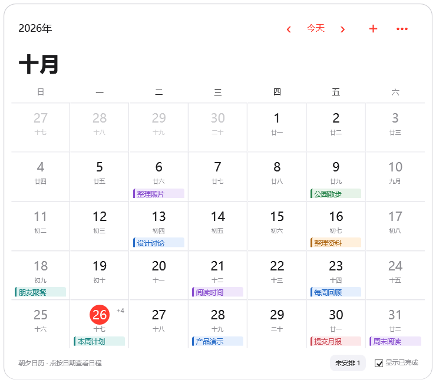
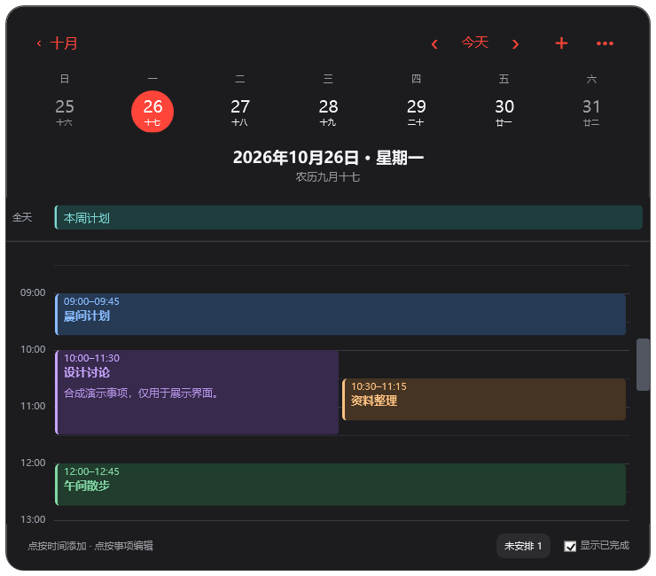

# Daynote · 朝夕日历

**v2.4.1** · 一个将日历和提醒留在 Windows 桌面上的中文小组件。

用月视图浏览安排，点击日期查看当天的时间轴。事项和设置保存在本机，不需要账号，也不提供云同步。

这是独立开发的 Windows 桌面应用，与 Apple 及其日历产品无关联。项目仅使用 Windows / .NET 系统组件，图标由构建脚本绘制，未打包第三方字体或图形素材。

## 预览

以下界面仅使用虚构的演示事项。

| 月历 · 浅色 | 当天时间轴 · 深色 |
| --- | --- |
|  |  |

## 下载

下载 [Daynote v2.4.1 Windows 版](https://github.com/Gaikunxingle/daynote-desktop/releases/download/v2.4.1/Daynote-v2.4.1-windows-x64.zip)，完整解压后运行 `build/Daynote.exe`。发行包不包含任何个人日程，全新用户首次启动为空白日历。历史版本和文件校验值见 [Releases](https://github.com/Gaikunxingle/daynote-desktop/releases)。也可以按下文从源码构建。

**从旧版升级：**先从托盘退出旧版，再运行新版或安装脚本。新版首次启动会迁移已有事项并保留原件；迁移后请使用新版程序或更新后的快捷方式，避免继续用旧版编辑另一份数据。

## 功能

- 月视图显示星期、农历和事项摘要；当天事项较多时显示数量提示。
- 日视图支持全天事项、时间段、跨夜日程和并排显示的重叠日程。
- 截止待办固定显示在日历下方，不随所选日期变化；按截止日期排序，标明剩余天数或逾期状态，完成后收起。
- 六种事项颜色，支持备注、完成状态、编辑和删除；无日期事项单独收纳。
- 浅色、深色和跟随系统主题，提供四种小组件尺寸。
- 可贴在桌面上，位于普通软件窗口后面；默认固定在主显示器右上角。
- 支持多显示器环境中的重新定位，并在显示配置变化后保留当前视图。
- 双击无操作的空白区域放大查看，再次双击或按 `Esc` 恢复。
- 拖动四边和四角连续调整尺寸；拖动中间分界线分配日程和截止待办的空间，尺寸与分区比例自动保存。
- 本地定时提醒、托盘菜单、开机启动和数据备份导出。

## 运行环境

- Windows 10 / Windows 11，x64。
- .NET Framework 4.8。
- 使用源码构建时需要 Windows PowerShell 和 .NET Framework 的 C# 编译器；当前构建脚本不依赖 NuGet 或 .NET SDK。

桌面贴靠依赖 Windows Explorer。若当前桌面或缩放环境无法挂接，程序会回到普通窗口模式；也可在菜单中关闭“贴在桌面”。

## 编译、运行与安装

下载本仓库源码并解压，在项目根目录打开 PowerShell，执行：

```powershell
powershell.exe -NoProfile -ExecutionPolicy Bypass -File .\build.ps1
```

生成的程序和配套文件位于 `build` 目录。直接运行即可使用：

```powershell
.\build\Daynote.exe
```

请保留同目录下的 `Daynote.exe.config` 和图标文件。如果使用包含 `build` 目录的发行包，可以跳过编译。

需要桌面快捷方式和开机启动时，在项目根目录运行：

```powershell
powershell.exe -NoProfile -ExecutionPolicy Bypass -File .\install.ps1
```

安装不需要管理员权限，程序保存到 `%LOCALAPPDATA%\Programs\Daynote`。安装脚本创建桌面和开始菜单中的“朝夕提醒”快捷方式，并注册当前用户的卸载入口。首次安装默认启用登录后自动启动；升级时保留原来的开机启动设置，之后可在程序菜单中调整。

要卸载，在 Windows 的“设置 → 应用”中找到“朝夕提醒”，或运行安装目录中的 `uninstall.ps1`。卸载会保留事项数据。

## 使用方法

### 浏览与编辑

点月历中的日期进入日视图，用顶部日期条切换当天所在周的日期；左右箭头用于切换月份或日期，“今天”用于回到今天。

点“＋”添加事项，或在日视图的时间轴空白处点击，预填对应的开始时间。点已有事项进行编辑，右键可完成、恢复或删除。底部“未安排”用于管理没有日期的事项，“显示已完成”控制已完成事项的显示。

结束时间可以不填。跨夜日程需同时选择结束日期；未设置结束时间的色块只表示一个待办，并不代表已确定的持续时长。

### 截止待办

在日历下方“截止待办”右侧点“＋ 添加”，填写名称和截止日期；需要精确到钟点时勾选“截止时刻”。也可以在现有事项的编辑窗口将类型改为“截止待办”。

截止待办在完成前每天显示，不受月历或日视图选中的日期影响。列表按截止日期排序，逾期后继续保留；事项较多时可在列表内滚动。点击圆圈完成，点击标题编辑；“已完成”可展开历史并恢复待办。这个列表的完成状态筛选独立于普通日程。

仅设置截止日期时，当天全天均可完成，次日才算逾期。截止待办不占用上方课程时间轴。

### 调整大小和分区

鼠标移到卡片四边或四角，出现双向箭头后按住拖动，可连续改变长宽。尺寸受可读的最小大小和所在屏幕工作区限制；开启右上角固定时，松手后保持右上角位置。选择菜单中的预设尺寸仍然可用。

拖动日程与截止待办之间的细分界线，可上下分配空间；两个区域都保留最低可用高度。尺寸和分区比例会保存，重新打开、切换日/月视图或放大后继续生效。拖动期间按 `Esc` 取消本次调整。全屏时可以调整分界线，先退出全屏再拖外边缘改变卡片大小。

### 放大与恢复

双击标题旁的空白区域或日视图的农历标题，可放大到**当前显示器的可用区域**，保留任务栏。再次双击这些区域，或按 `Esc`，恢复原来的小卡片。

卡片边缘用于调整大小；日期格、事项、按钮和时间轴维持原有操作，双击这些区域不会触发放大。右上角“•••”菜单也提供“放大到全屏”和“恢复小卡片”。放大不会修改保存的小卡片尺寸。

### 桌面位置与多显示器

默认以紧凑尺寸固定在主显示器右上角。显示器连接、主屏、分辨率或缩放比例变化后，程序会重新定位，并保留正在查看的月份、日期和滚动位置。

如需手动移动，先在菜单中取消“固定在主屏右上角”，再拖动年份、月份或日期标题。菜单提供迷你、紧凑、舒展和宽大四种尺寸。

双击托盘图标或重新打开快捷方式，可将小卡片暂时带到前面；默认约 20 秒后回到桌面层。

### 提醒

在事项编辑窗口中选择准时提醒或提前提醒。全天事项以当天 **09:00** 为提醒基准，未设置日期的事项不发送定时提醒。

提醒需要程序保持运行。关机、休眠或退出期间不会实时弹出；恢复运行后，会补发未发送的提醒。修改开始时间或提前提醒设置会重新安排提醒，仅修改备注、颜色或结束时间不会重复提醒。

### 快捷键

| 快捷键 | 操作 |
| --- | --- |
| `Ctrl+N` | 添加事项 |
| `Ctrl+Enter` | 在编辑窗口中保存 |
| `Esc` | 放大状态下恢复小卡片；小卡片的日视图返回月视图 |

## 数据与隐私

运行时数据保存在 `%USERPROFILE%\Daynote\Data`（例如 `C:\Users\你的用户名\Daynote\Data`）：

- `reminders.json`：事项和设置。
- `reminders.json.bak`：上一次保存的备份，会随后续保存更新。

2.4.1 将默认数据移出 AppData，避免从打包应用启动和从桌面启动时，Windows 文件虚拟化将同一路径映射到不同文件。第一次启动会检查旧的 `%LOCALAPPDATA%\Daynote\Data` 和应用缓存里的 Daynote 数据；只有一份有效非空数据时自动复制，保留原件。多份非空数据不一致时会停止并提示，不擅自合并或用空列表覆盖。新位置已有数据后，不再从旧位置重复导入。显式 `--data-dir` 仍用于独立资料或测试，不触发默认迁移。

程序不上传事项，不使用账号，也不与外部日历或云端同步。可以从菜单导出备份；手动复制或恢复数据文件前，请先退出程序。升级与卸载不会主动清空事项。

## 测试

在项目根目录执行：

```powershell
powershell.exe -NoProfile -ExecutionPolicy Bypass -File .\test.ps1
```

脚本会编译并运行四组检查：

- `CoreTests`：数据保存、备份恢复、版本迁移和提醒触发规则。
- `CalendarLogicTests`：农历与月历计算、跨夜日程和重叠时间段布局。
- `ResizeGeometryTests`：边缘拖动、屏幕边界和 DPI 换算。
- `DataPathsTests`：固定数据位置、旧数据迁移、空副本与冲突保护。

测试使用隔离的临时目录，完成后清理，无需启动应用。界面、桌面贴靠和多显示器交互的修改，还应在实际 Windows 桌面中验证。

## 参与开发

贡献方式与提交前检查见 [CONTRIBUTING.md](CONTRIBUTING.md)，版本变化见 [CHANGELOG.md](CHANGELOG.md)。

## 许可证

本项目采用 [MIT 许可证](LICENSE)，允许使用、修改与分发；分发时请保留版权和许可声明。
